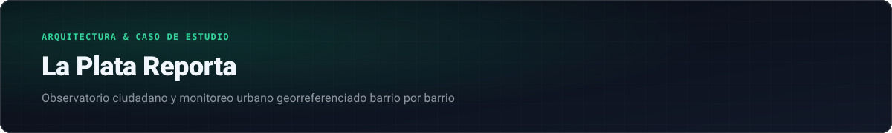
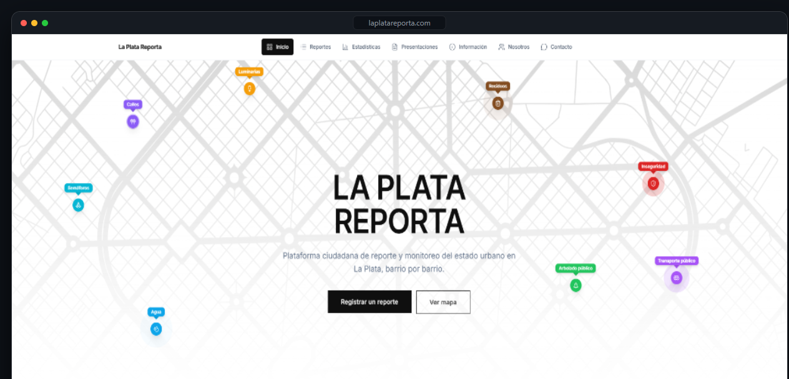
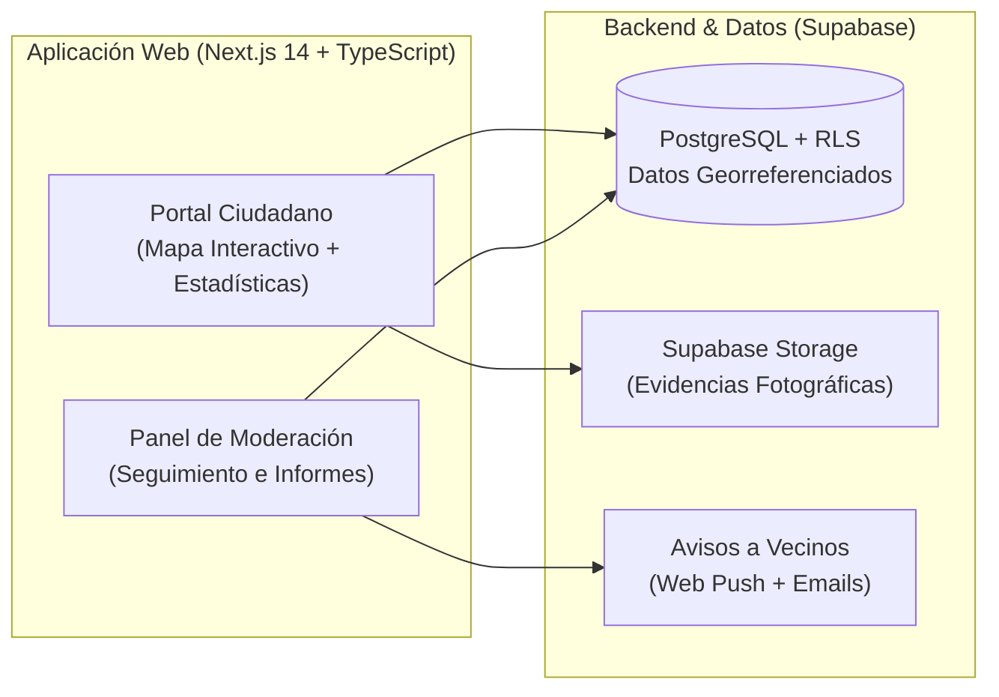

  

 

  <a href="./README.md">← Volver al perfil</a>
  &nbsp;·&nbsp;
  <a href="https://www.laplatareporta.com/" target="_blank"><b>Visitar plataforma en vivo (laplatareporta.com) →</b></a>

 

  

---

### Por qué hicimos La Plata Reporta

Los problemas cotidianos en la vía pública —luminarias apagadas, baches, pérdidas de agua, semáforos sin funcionar o acumulación de residuos— muchas veces quedan en reclamos aislados que se pierden sin seguimiento.

Desarrollamos **[La Plata Reporta](https://www.laplatareporta.com/)** para ordenar esa información en un mapa público y abierto: cualquier vecino puede subir un reporte con foto y ubicación exacta, otros vecinos de la cuadra pueden confirmarlo (*"Yo también vi esto"*) para darle visibilidad, y todos pueden consultar las estadísticas por barrio y el estado de cada reclamo (`Reportado` → `Presentado` → `Solucionado`).

---

### Arquitectura de la plataforma

---

### Detalles técnicos del desarrollo

#### 1. Mapas interactivos y análisis espacial
- **Cartografía con Leaflet y TopoJSON:** Usamos `react-leaflet` y OpenStreetMap combinados con capas vectoriales para delimitar los barrios y visualizar cada categoría con su propio marcador en el mapa.
- **Geometría con Turf.js:** Cuando un vecino selecciona un punto en el mapa, el sistema calcula el radio cercano para detectar si ese mismo problema ya fue reportado a pocos metros, evitando reclamos duplicados y sumando el apoyo al reporte original.
- **Mapas de calor y métricas:** Incorporamos `leaflet.heat` y gráficos con `Recharts` para identificar rápidamente qué zonas y qué categorías concentran más reclamos en el tiempo.

#### 2. Experiencia en celular y notificaciones
- **Compresión de fotos en el navegador:** Como la mayoría de los reportes se suben desde el celular en la calle con datos móviles, comprimimos las imágenes en el navegador del usuario antes de enviarlas al servidor, logrando que la carga sea rápida incluso con poca señal.
- **Avisos automáticos:** Cuando un reclamo cambia de estado o pasa a instancia de presentación, los vecinos que participaron reciben una notificación Push o un correo electrónico con la actualización.

#### 3. Privacidad de los vecinos
- **Seguridad en base de datos (RLS):** Configuramos políticas de acceso en PostgreSQL para que las coordenadas, fotos y estadísticas de los reclamos sean públicas y transparentes, pero los datos personales de quien reporta queden resguardados.

---

  <a href="./README.md"><b>← Volver al perfil principal</b></a>

