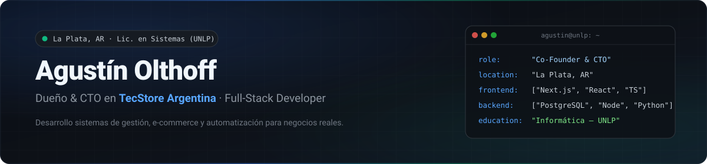
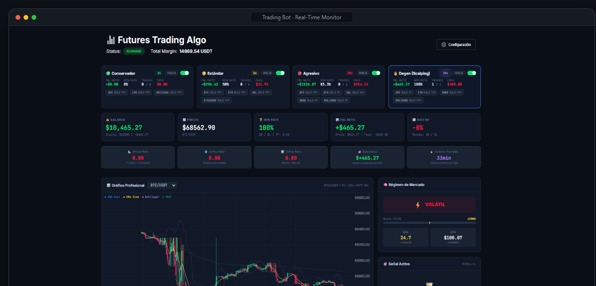

  

 

  
  &nbsp;
  
  &nbsp;
  
  &nbsp;
  
  &nbsp;
  
  &nbsp;
  

 

Estudio **Licenciatura en Sistemas** en la **Facultad de Informática (UNLP)** y soy socio y **CTO de [TecStore Argentina](https://tecno.tecstore.lat/)**. Empecé programando herramientas para automatizar el día a día de mi propio negocio y terminé desarrollando desde cero el sistema de gestión (ERP), las tiendas online y los bots con los que hoy operamos nuestras **3 sucursales físicas** (**Buenos Aires CABA**, **La Plata** y **Villa Minetti, Santa Fe**).

---

### Sistemas en producción y proyectos propios

<table>
  <tr>
    <td width="54%" valign="top">
      <h4><a href="./TecStore-CaseStudy.md">TecStore Tecnología — ERP &amp; Tienda Web</a></h4>
      

        <code>Next.js 14</code> · <code>React 19</code> · <code>TypeScript</code> · <code>Supabase</code> · <code>Tailwind</code>
      

      

        Sistema de gestión interno y tienda e-commerce que desarrollé como CTO para unificar la operación de nuestras tres sucursales físicas y el canal online (+300K seguidores).
      

      <ul>
        <li>Control de stock por sucursal y por lotes, punto de venta (POS) y seguimiento de envíos en vivo.</li>
        <li>Módulo contable para socios, cotizador de iPhones usados en parte de pago y programa de puntos (TecPoints).</li>
      </ul>
      

        <a href="./TecStore-CaseStudy.md"><b>Leer arquitectura y caso de estudio →</b></a>
        &nbsp;·&nbsp;
        <a href="https://tecno.tecstore.lat/">tecno.tecstore.lat</a>
      

    </td>
    <td width="46%" valign="middle" align="center">
      
    </td>
  </tr>

  <tr>
    <td width="54%" valign="top">
      <h4><a href="./TecStore-Games-CaseStudy.md">TecStore Games — E-Commerce Multi-País</a></h4>
      

        <code>React</code> · <code>Vite</code> · <code>PostgreSQL</code> · <code>Edge Functions</code> · <code>Node.js</code>
      

      

        Tienda online regional (Argentina y LATAM) para la venta de videojuegos digitales de PS4 y PS5, conectada a un panel propio de administración y entregas automatizadas.
      

      <ul>
        <li>Catálogo con precios localizados por país, buscador con soporte de alias/siglas, cajas misteriosas y referidos.</li>
        <li>Sincronización automática de ofertas y bots en Node.js que entregan los pedidos por WhatsApp las 24 hs.</li>
      </ul>
      

        <a href="./TecStore-Games-CaseStudy.md"><b>Leer arquitectura y caso de estudio →</b></a>
        &nbsp;·&nbsp;
        <a href="https://tecstore.lat/ar">tecstore.lat/ar</a>
      

    </td>
    <td width="46%" valign="middle" align="center">
      
    </td>
  </tr>

  <tr>
    <td width="54%" valign="top">
      <h4><a href="./LaPlataReporta-CaseStudy.md">La Plata Reporta — Observatorio Urbano</a></h4>
      

        <code>Next.js 14</code> · <code>TypeScript</code> · <code>Leaflet</code> · <code>Turf.js</code> · <code>Supabase</code>
      

      

        Plataforma web abierta para que los vecinos de La Plata puedan registrar, geolocalizar y hacer seguimiento de problemas urbanos barrio por barrio.
      

      <ul>
        <li>Mapa interactivo con capas barriales, detección espacial de reportes cercanos, mapas de calor y estadísticas públicas.</li>
        <li>Sistema de validación comunitaria, propuestas vecinales y avisos de avance por notificaciones Push y mail.</li>
      </ul>
      

        <a href="./LaPlataReporta-CaseStudy.md"><b>Leer arquitectura y caso de estudio →</b></a>
        &nbsp;·&nbsp;
        <a href="https://www.laplatareporta.com/">laplatareporta.com</a>
      

    </td>
    <td width="46%" valign="middle" align="center">
      
    </td>
  </tr>

  <tr>
    <td width="54%" valign="top">
      <h4><a href="https://github.com/AgustinOlthoff/cpu-scheduler-sim">CPU Scheduler Simulator — Sistemas Operativos (UNLP)</a></h4>
      

        <code>React 18</code> · <code>Vite</code> · <code>CSS</code> · <code>Vercel</code>
      

      

        Simulador web que armé para practicar los algoritmos de planificación de CPU de la materia <b>Introducción a los Sistemas Operativos (ISO)</b> de la facultad.
      

      <ul>
        <li>Permite correr 7 variantes (FCFS, SJF, SRTF, Round Robin y Prioridades) sumando interrupciones de Entrada/Salida (DMA).</li>
        <li>Dibuja el diagrama de Gantt paso a paso, muestra la cola de listos y calcula Tiempo de Retorno y de Espera.</li>
      </ul>
      

        <a href="https://github.com/AgustinOlthoff/cpu-scheduler-sim"><b>Ver código en GitHub →</b></a>
        &nbsp;·&nbsp;
        <a href="https://cpu-scheduler-sim-two.vercel.app">Probar simulador</a>
      

    </td>
    <td width="46%" valign="middle" align="center">
      
    </td>
  </tr>

  <tr>
    <td width="54%" valign="top">
      <h4><a href="https://github.com/AgustinOlthoff/BotTrading">Bot de Trading Algorítmico &amp; Dashboard</a></h4>
      

        <code>Python</code> · <code>React</code> · <code>Lightweight Charts</code> · <code>Telegram API</code>
      

      

        Sistema automatizado en Python para operar futuros en Binance con distintos perfiles de riesgo en paralelo y un panel web local para monitorear métricas.
      

      <ul>
        <li>Cálculo dinámico de tamaño de posición, filtros de volatilidad/tendencia (ADX, EMA, RSI, VWAP) y control de drawdown.</li>
        <li>Panel en React con gráficos en vivo y bot de Telegram para consultar estado o pausar estrategias desde el celular.</li>
      </ul>
      

        <a href="https://github.com/AgustinOlthoff/BotTrading"><b>Ver código en GitHub →</b></a>
      

    </td>
    <td width="46%" valign="middle" align="center">
      
    </td>
  </tr>
</table>

---

### Otros repositorios y herramientas

| Repositorio | Qué hace | Stack |
| :--- | :--- | :--- |
| [**quotadeck-ai**](https://github.com/AgustinOlthoff/quotadeck-ai) | App de escritorio liviana para monitorear el consumo de cuota en editores con IA y cambiar de cuenta en un clic. | `Tauri` `Rust` `TypeScript` `React` |
| [**marketplacedescentralizado**](https://github.com/TP-Seminario-de-Lenguajes-Rust-2025/marketplacedescentralizado) | Trabajo final del Seminario de Lenguajes (UNLP): marketplace en blockchain con contratos inteligentes. | `Rust` `Ink!` `Substrate` |
| [**whatsapp-ticket-bot**](https://github.com/AgustinOlthoff/whatsapp-ticket-bot) | Bot que recibe fotos de comprobantes o tickets por WhatsApp, lee los montos con OCR + Gemini y los pasa a Google Sheets. | `Node.js` `Gemini API` `Tesseract.js` |
| [**whatsapp-pedidos-empleados**](https://github.com/AgustinOlthoff/whatsapp-pedidos-empleados) | Automatización interna para avisar por WhatsApp cuando llegan pedidos al depósito y llevar control de saldos. | `Node.js` `Google Sheets API` |
| [**ruleta-promocional-react**](https://github.com/AgustinOlthoff/ruleta-promocional-react) | Módulo web de ruleta de premios validada por número de orden de compra para campañas de clientes. | `React` `Vite` `Tailwind` `Framer Motion` |
| [**tracking-tecstore-md**](https://github.com/AgustinOlthoff/tracking-tecstore-md) | Primera versión standalone del portal de seguimiento de envíos para clientes de TecStore. | `React` `Vite` `Framer Motion` |

---

### Stack con el que trabajo a diario

  

