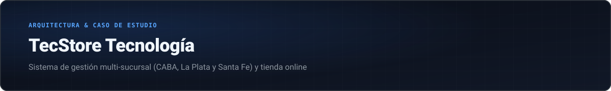
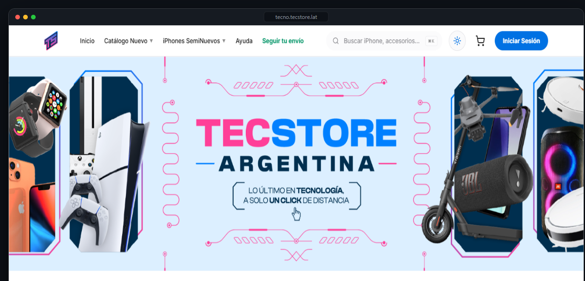
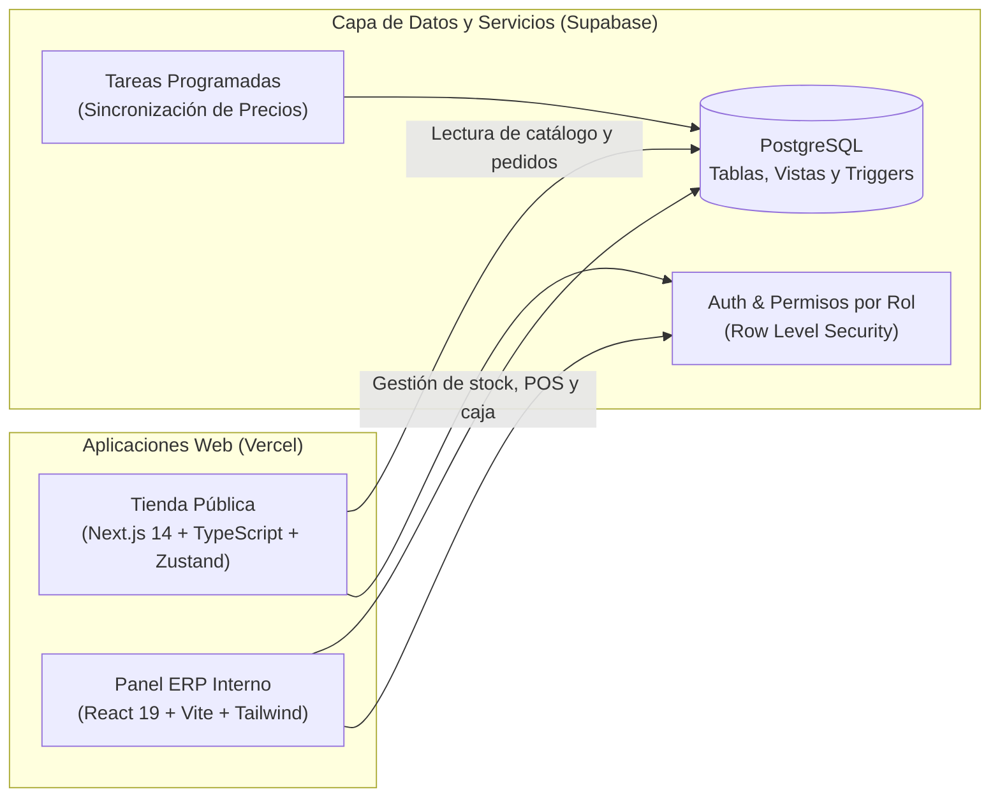

  

 

  <a href="./README.md">← Volver al perfil</a>
  &nbsp;·&nbsp;
  <a href="https://tecno.tecstore.lat/" target="_blank"><b>Visitar tienda en vivo (tecno.tecstore.lat) →</b></a>

 

  

> **Nota:** El código fuente de este proyecto se mantiene en repositorios privados porque es el sistema con el que operamos comercialmente todos los días. Armé este resumen para documentar cómo está pensada la arquitectura y qué problemas resolvimos al construirlo.

---

### Contexto: por qué armamos un sistema propio

En **TecStore Argentina** (+300.000 seguidores en Instagram) vendemos equipos Apple, smartphones y accesorios tanto por internet como en nuestras **3 sucursales físicas**:
- **Buenos Aires (CABA)**
- **La Plata (Provincia de Buenos Aires)**
- **Villa Minetti (Provincia de Santa Fe)**

Al principio llevábamos el stock, los envíos y los números en planillas compartidas. Cuando el volumen de ventas creció y sumamos sucursales, ese esquema dejó de escalar: era difícil saber en tiempo real qué unidades estaban disponibles en cada local, cuánto tardaba en salir un despacho o cómo cerraba la caja entre los socios.

Como socio y CTO del negocio, decidí desarrollar una plataforma a medida dividida en dos aplicaciones conectadas a la misma base de datos en **Supabase (PostgreSQL)**: la tienda pública y el ERP interno.

---

### Arquitectura general

---

### Qué resuelve cada parte

#### 1. La tienda online (`Next.js 14 + TypeScript`)
- **Catálogo nuevo y seminuevo:** Muestra los productos disponibles con precios actualizados automáticamente según la cotización del día.
- **Cotizador de Plan Canje:** Permite que un cliente elija el modelo de su iPhone actual, indique el estado estético y porcentaje de batería, y obtenga una cotización estimada para entregarlo en parte de pago.
- **Seguimiento de envíos:** Pantalla pública donde el comprador consulta en qué etapa está su paquete sin tener que escribir a soporte.
- **Programa de puntos (TecPoints) y Ruleta:** Los clientes suman puntos con cada compra para canjearlos en un kiosco de premios o girar una ruleta promocional validada contra su orden.

#### 2. El ERP interno (`React 19 + Vite`)
- **Stock multi-sucursal y por lotes:** Permite ver qué mercadería hay en **CABA, La Plata y Santa Fe**, registrar compras a proveedores y mover stock entre locales.
- **Trazabilidad de usados:** Cada teléfono usado entra al sistema como una unidad única con su condición, batería, costo y etiqueta propia.
- **Punto de Venta (POS):** Unifica los pedidos que entran por la web con las ventas de mostrador de cada sucursal, aceptando pagos combinados.
- **Módulo financiero y cuentas de socios:** Lleva el flujo de caja diario por partida doble, calcula el balance de cada socio y genera los cierres mensuales y gráficos de rendimiento con `Recharts`.
- **Actualización desatendida de referencias:** Tareas programadas (Cron) que consultan precios de referencia del mercado en segundo plano para ayudar a mantener el catálogo competitivo.

---

### Seguridad e integridad de datos

Al compartir la misma base de datos entre la tienda pública y el sistema interno, trabajamos fuerte en la seguridad a nivel PostgreSQL:
- **Separación por vistas y Row Level Security (RLS):** La tienda pública nunca consulta las tablas operativas completas; lee únicamente vistas públicas con los campos comerciales, mientras que la información sensible queda restringida al personal autorizado de las sucursales.
- **Reglas garantizadas en la base:** Las validaciones importantes (por ejemplo, impedir que se publique un artículo sin precio o descontar stock al confirmar una venta) corren mediante *triggers* y funciones transaccionales en la base de datos, no solo en el navegador.

---

  <a href="./README.md"><b>← Volver al perfil principal</b></a>

