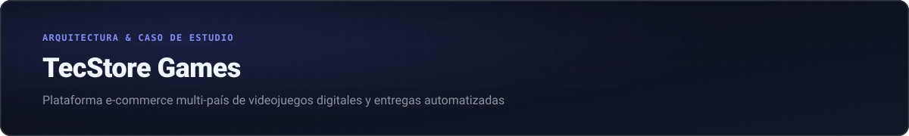
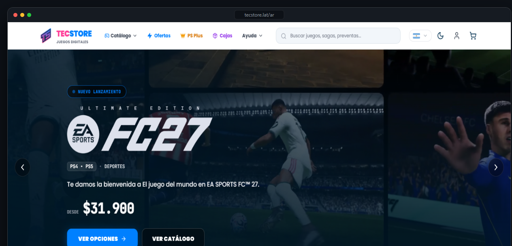
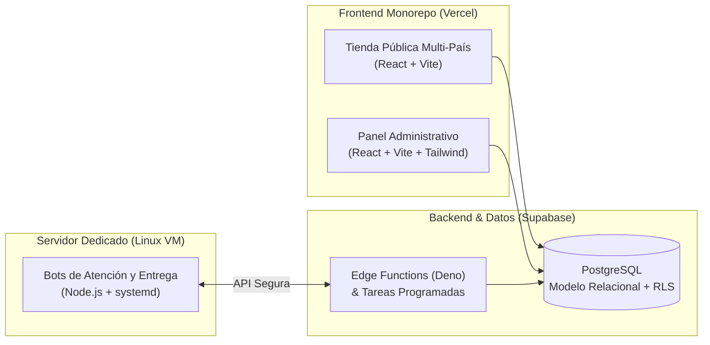

  

 

  <a href="./README.md">← Volver al perfil</a>
  &nbsp;·&nbsp;
  <a href="https://tecstore.lat/ar" target="_blank"><b>Visitar tienda en vivo (tecstore.lat/ar) →</b></a>

 

  

> **Nota:** Este proyecto es de código cerrado porque corresponde a nuestra plataforma comercial en producción. Acá resumo cómo está diseñada la arquitectura y las automatizaciones que desarrollé para escalar la operación.

---

### De qué trata el proyecto

**TecStore Games** ([tecstore.lat/ar](https://tecstore.lat/ar)) es nuestra tienda online dedicada a la venta de videojuegos digitales para PlayStation 4 y PlayStation 5. Nació para el mercado argentino y luego la expandimos a toda **LATAM**, adaptando la moneda, los medios de pago y el catálogo según el país desde donde entra cada usuario.

---

### Arquitectura del sistema

---

### Qué construimos en la plataforma

#### 1. Catálogo multi-país y buscador propio
- **Precios y moneda por región:** La tienda detecta el país del usuario en Argentina y LATAM y muestra todos los precios convertidos en su moneda local desde la base de datos, sin valores fijos en el código del frontend.
- **Buscador adaptado a videojuegos:** Muchos usuarios buscan por siglas o sin números romanos (por ejemplo, escriben *"gta 5"*, *"fc"* o *"cod"*). Armamos un buscador unificado tanto en el cliente como en PostgreSQL que normaliza acentos, caracteres especiales y alias configurables desde el panel.
- **Actualización automática de campañas:** Mediante funciones programadas en la nube (`pg_cron` + Edge Functions), el sistema actualiza precios y arma campañas de ofertas automáticamente.

#### 2. Inventario relacional y entregas por WhatsApp
- **Control estricto de stock:** El inventario se apoya en índices únicos y funciones transaccionales en PostgreSQL para asegurar que una misma licencia digital nunca pueda asignarse dos veces aunque entren compras al mismo tiempo.
- **Bots de entrega en servidor propio:** Para que el cliente no tenga que esperar a un operador humano, programamos un servicio en `Node.js` que corre en una máquina virtual Linux. Cuando el pedido se confirma, el bot se comunica por WhatsApp, envía el instructivo paso a paso y despacha los accesos automáticamente.

#### 3. Fidelización y herramientas para el equipo
- **Cajas misteriosas, puntos y referidos:** Sumamos mecánicas de puntos por compra, apertura de cajas promocionales y un sistema de códigos para creadores de contenido e invitaciones entre amigos.
- **Generador de piezas para redes:** Adentro del mismo panel administrativo incluimos un editor que toma cualquier juego en oferta y exporta la historia para Instagram en formato `PNG` con el precio del día, ahorrándole horas de diseño manual al equipo.

---

  <a href="./README.md"><b>← Volver al perfil principal</b></a>

